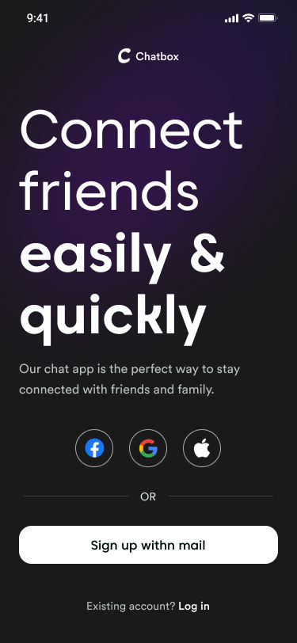
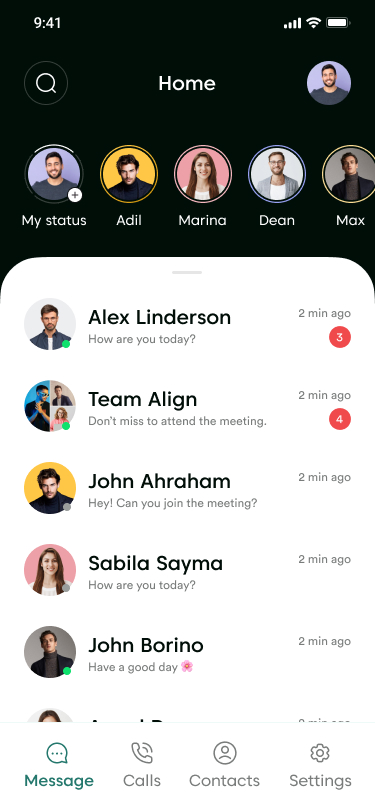
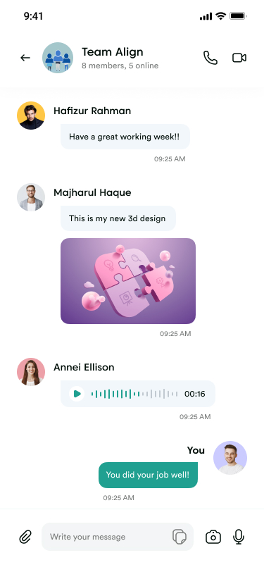
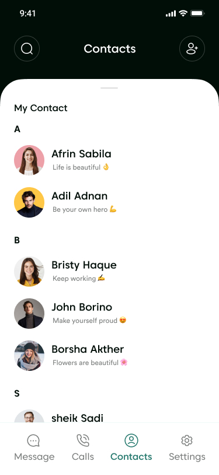

<div align="center">

  # 💬 ChatApp

  **A modern, feature-rich real-time chat and story application built with Flutter & Firebase.**

  [](https://flutter.dev)
  [](https://firebase.google.com)
  [](https://cloudinary.com)
  [](https://bloclibrary.dev)
  [](LICENSE)

</div>

---

## 🌟 Overview

**ChatApp** is a production-ready mobile communication platform crafted with Flutter and Firebase. Combining the sleek aesthetics of modern social messaging platforms with high-performance real-time synchronization, ChatApp offers 1-on-1 messaging, group conversations, media attachments, and 24-hour disappearing status stories.

---

## 📱 App Screenshots

<div align="center">
  <table>
    <tr>
      <th align="center" width="25%">Onboarding</th>
      <th align="center" width="25%">Messages & Stories</th>
      <th align="center" width="25%">Chat Conversation</th>
      <th align="center" width="25%">Contacts Directory</th>
    </tr>
    <tr>
      <td></td>
      <td></td>
      <td></td>
      <td></td>
    </tr>
  </table>
</div>

> 🎨 **UI/UX Design:** Inspired by the community Figma design [Messaging - Chatbox App Design](https://www.figma.com/design/pvRHWv30LJ5nWykO6JTJHJ/Messaging---Chatbox-App-Design--Community-?node-id=0-1&p=f&t=8kLwAlw5jVtIpJQH-0).

---

## ✨ Features

### 💬 Real-Time Messaging & Conversations
- **1-on-1 Direct Messaging:** Instant real-time message delivery powered by Cloud Firestore.
- **Group Chats:** Create groups with custom names, group profile avatars, and multi-user participation.
- **Rich Media Attachments:** Send high-resolution photos and documents directly inside conversations.
- **Live Online Presence:** Real-time active status tracking (*"Active Now"*, *"Last seen"*).

### 📸 24-Hour Status & Stories Module
- **Disappearing Stories:** Post ephemeral photo updates that automatically expire after 24 hours.
- **Multiple Status Slides:** Upload consecutive statuses with smooth sequential browsing and a dynamic **`1 of n`** indicator.
- **"Seen By" Viewer Insights:** Tap the viewer pill (*"👁️ X views"*) to slide up a list of all contacts who viewed your status, including profile pictures and names.
- **Pinch-to-Zoom & Pan:** Full `InteractiveViewer` zoom integration for detailed photo viewing.
- **Dynamic Time-Ago Stamps:** Real-time formatted status timestamps (*"just now"*, *"15 minutes ago"*, *"2 hours ago"*).
- **Owner Controls:** Delete your own active status slides anytime with confirmation dialogs.
- **Unseen Ring Indicators:** Highlight rings around user avatars distinguishing seen vs unseen updates.

### 👥 Contacts, Profiles & Settings
- **User Discovery:** Browse and search through registered contacts with instant chat initiation.
- **Customizable Profiles:** Update profile pictures, display names, and status messages.
- **Cloudinary CDN Integration:** Fast and reliable cloud media storage for statuses and chat attachments.
- **Offline Caching & Shimmers:** Smooth `CachedNetworkImage` loading states with progress indicators and broken-image recovery.

---

## 🏗️ Architecture & Tech Stack

```
lib/
├── core/                       # Shared app-wide resources & utilities
│   ├── constants/              # Assets, colors, typography, strings, keys
│   ├── data/models/            # Shared data models (UserModel, etc.)
│   ├── routes/                 # Named routing & RouteGenerator
│   ├── services/               # Cloudinary & third-party services
│   ├── utils/                  # Date formatting, ID generators, image pickers
│   └── widgets/                # Common reusable UI components (Avatar, Buttons, etc.)
└── features/                   # Feature-first modular architecture
    ├── auth_module/            # Google Sign-In, Firebase Auth, Splash, Onboarding
    ├── call_module/            # Call history and logs
    ├── contacts_module/        # Contact listing and discovery
    ├── messages_module/        # Chat listing, details, bubble widgets, group creation
    ├── profile_module/         # User profile views
    ├── search_module/          # Search functionality across chats & contacts
    ├── settings_module/        # Settings screen, profile edit, preferences
    ├── status_module/          # Story status posting, preview, and story viewer
    └── tab_bar/                # Persistent bottom navigation controller
```

### Technology Highlights
- **Framework:** [Flutter](https://flutter.dev) (Dart 3+)
- **State Management:** [flutter_bloc](https://pub.dev/packages/flutter_bloc) (BLoC / Cubit pattern for predictable state transitions)
- **Database & Auth:** [Firebase Firestore](https://firebase.google.com/docs/firestore) & [Firebase Authentication](https://firebase.google.com/docs/auth)
- **Media Hosting:** [Cloudinary API](https://cloudinary.com)
- **Image Caching:** [cached_network_image](https://pub.dev/packages/cached_network_image)
- **Styling:** Custom design system with curated typography (`Caros`, `CircularStd`) and color palette (`#24786D` emerald theme).

---

## 🚀 Getting Started

### Prerequisites
- [Flutter SDK](https://docs.flutter.dev/get-started/install) (`>=3.0.0`)
- [Dart SDK](https://dart.dev/get-dart)
- [Firebase CLI](https://firebase.google.com/docs/cli)
- An active Firebase Project
- An active [Cloudinary](https://cloudinary.com) account

### Installation

1. **Clone the repository:**
   ```bash
   git clone https://github.com/Dhiren507/chatapp-flutter_firebase.git
   cd chatapp-flutter_firebase
   ```

2. **Install dependencies:**
   ```bash
   flutter pub get
   ```

3. **Configure Firebase:**
   - Generate your `firebase_options.dart` or link your project:
     ```bash
     flutterfire configure
     ```
   - For Android: Place `google-services.json` in `android/app/`.
   - For iOS: Place `GoogleService-Info.plist` in `ios/Runner/`.

4. **Run the application:**
   ```bash
   flutter run
   ```

---

## 🤝 Contributing

Contributions, issues, and feature requests are welcome! Feel free to check the [issues page](https://github.com/Dhiren507/chatapp-flutter_firebase/issues).

1. Fork the Project
2. Create your Feature Branch (`git checkout -b feature/AmazingFeature`)
3. Commit your Changes (`git commit -m 'Add some AmazingFeature'`)
4. Push to the Branch (`git push origin feature/AmazingFeature`)
5. Open a Pull Request

---

## 📄 License

This project is licensed under the MIT License - see the [LICENSE](LICENSE) file for details.
